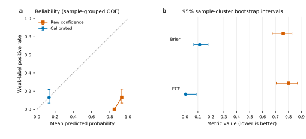

# OntoBridg Supplementary Material

This supplement accompanies *OntoBridg: Fail-Closed Evaluation of Open-Relation Ontology Learning*. It contains protocol details and secondary analyses that are necessary for auditability but not for the main narrative. All official-data results use public LLMs4OL 2026 training files; no hidden-test result is reported.

## A. Evidence and Claim Ledger

| Artifact family | Frozen before generation | Gold used in prompts | Claim scope | Final gate |
|---|---:|---:|---|---|
| Blind Task A/B prefix | Yes | No | Gold-withheld train-prefix comparison | Non-deployable |
| Density-stratified guard | Yes | No | Gold-stratified relation-filtering diagnostic | Non-deployable |
| Independent v2 calibration | Yes | No | Candidate calibration support | Failed: 3 positive samples |
| Dual-model weak annotation | Yes | No | Exploratory weak-label calibration | Human/confirmatory ineligible |
| V5 confirmatory | Yes | No | Frozen threshold validation | Failed: 3 positive samples after calibration |
| Contamination probe | Yes | No task context | Factual probeability, not membership | Diagnostic only |
| Endpoint-alias stress | Yes | No gold | Surface sensitivity | Diagnostic only |
| Nonce relation holdout | Yes | No | Controlled synthetic extraction | Non-deployable |
| Official relation transfer | Yes | No | Disjoint official-train transfer | Failed: 0 TP |
| Predicate routing | Yes | No | Independent mechanism test | Failed: 2 of 5 required samples |

The immutable manifests retain their freeze-time cache states, precommitted decision rules, and planned-call estimates. Completed result artifacts separately record actual attempts and final cache coverage. The manifests were frozen locally before execution but were not registered in a public preregistration service.

## B. Guarded-System Variants

The direct guarded prompts regenerate the full graph and therefore can change typing and taxonomy output. The hybrid variants preserve the legacy open system's typing and taxonomy triples and replace only the relation channel. The latter is the interpretable comparison for the relation guard.

| Task | System | Typing F1 | Taxonomy F1 | NonTax F1 | Exact GS | Composite |
|---|---|---:|---:|---:|---:|---:|
| A | Open | 0.3077 | 0.3475 | 0 | 0.1825 | 0.2793 |
| A | Direct guarded v1 | 0.0310 | 0.2405 | 0 | 0.1512 | 0.1409 |
| A | Hybrid guarded v1 | 0.3077 | 0.3475 | 0 | 0.2140 | 0.2897 |
| A | Direct guarded v2 | 0.3396 | 0.3771 | 0 | 0.1974 | 0.3047 |
| A | Hybrid guarded v2 | 0.3077 | 0.3475 | 0 | 0.2152 | 0.2901 |
| B | Open | 0.6000 | 0.7500 | 0.0202 | 0.5598 | 0.6366 |
| B | Direct guarded v1 | 0.1961 | 0.6000 | 0 | 0.4677 | 0.4213 |
| B | Hybrid guarded v1 | 0.6000 | 0.7500 | 0 | 0.6007 | 0.6502 |
| B | Direct guarded v2 | 0.1923 | 0.6861 | 0 | 0.4991 | 0.4592 |
| B | Hybrid guarded v2 | 0.6000 | 0.7500 | 0 | 0.5766 | 0.6422 |

The direct-v1 core-score regression is why the paper does not attribute hybrid Graph Similarity gains to better global generation. They arise from suppressing relation false positives while holding the other channels fixed.

## C. Calibration and Confirmatory Detail

### C.1 Independent v2 calibration

The independent v2 pool contains 177 raw candidates. After evidence and confidence checks but before quantity truncation, 144 candidates define the calibration population. Four are exact positives from three samples. Beta-isotonic calibration changes Brier/ECE from 0.8429/0.9024 to 0.0270/0.0113 on the fitted population. The artifact status is `insufficient_independent_positive_samples` because the precommitted minimum is five positive samples.

### C.2 Weak-label analysis

Two model routes independently annotate the same 30 contexts. They produce 114 and 105 relation assertions. Sample-exact agreement is 0.2000, macro relation-set Jaccard is 0.3646, and micro Jaccard is 0.3436. A third model route adjudicates the merged candidates, yielding 169 weak relations.

Among 200 eligible system candidates, 26 match weak labels across 14 samples. Five-fold sample-grouped out-of-fold calibration changes Brier/ECE from 0.7596/0.8005 to 0.1134/0.0045. Every fold nevertheless maps the raw 0.85-1.00 confidence range to one probability block between 0.124 and 0.140. The apparent calibration improvement is therefore stable base-rate shrinkage without ranking resolution.



**Figure S1. Exploratory weak-label calibration.** Reliability and uncertainty are conditioned on dual-model weak labels. They are not estimates against human or official relation truth and cannot open a confirmatory gate.

### C.3 Untouched confirmatory slice

The 24-sample v5 confirmatory set is balanced between endpoint-visible `equivalent class` and `disjoint with` gold. It has no sample overlap with prior experimental ledgers and was frozen before generation.

| System | Predictions | TP | Positive samples | Precision | Recall | F1 | Brier | ECE |
|---|---:|---:|---:|---:|---:|---:|---:|---:|
| Base v5 | 15 | 4 | 4 | 0.2667 | 0.0741 | 0.1159 | 0.6707 | 0.6840 |
| Frozen calibrated v5 | 14 | 3 | 3 | 0.2143 | 0.0556 | 0.0882 | 0.2109 | 0.1238 |

The frozen calibrator improves probability metrics but removes one exact true positive. The five-positive-sample decision gate fails. A 10,000-replicate sample-cluster bootstrap gives base F1 [0.0238, 0.2712], calibrated F1 [0, 0.2222], and calibrated-minus-base F1 [-0.1064, 0].

The frozen semantic secondary analysis uses `nomic-ai/nomic-embed-text-v1.5` at pinned revision `e9b6763` and threshold 0.90. Exact and semantic relation-only scores are identical for both base and calibrated systems: 0 of 24 samples improve, 24 remain unchanged, and 0 degrade. This secondary metric does not alter the failed exact confirmatory gate.

## D. Transfer and Routing Audits

### D.1 Official relation transfer

The official transfer slice contains 30 unused Task A samples allocated equally to equivalent-class, disjoint-with, and heterogeneous open-predicate strata. It provides 89 endpoint-visible and 101 total non-self non-taxonomic gold relations.

The raw guarded generator produces 225 candidates: 143 accepted and 82 rejected. No raw or rejected candidate is an exact true positive, and every candidate predicate falls outside the exact gold predicate inventory. Quantity limiting accounts for 40 rejections, missing endpoint evidence for 24, and non-verbatim evidence for 10. Among accepted outputs, `part_of` and `has part` account for 89 of 143 predictions. This audit localizes the primary failure before predicate routing; it does not authorize retuning on the inspected slice.

### D.2 Predicate routing

The routed system produces 193 raw target candidates, accepts 140, and rejects 53. Accepted outputs contain 120 `type`, 12 `same as`, 6 `has role`, and 2 `equivalent class` predicates. The quantity cap rejects 42 candidates; 12 samples reach the eight-relation cap and six contain at least one quantity-limit rejection.

Of 138 official exact false positives, 121 use explicit evidence and 17 use cross-sentence evidence. Both endpoints are bound verbatim to context for 133. These counts show that evidence and endpoint checks do not reproduce the reference graph's relation-selection policy. They do not establish semantic error because no independent adjudication is available.

## E. Legacy Oracle-Inventory Pilot

An early 10-sample Task A runner constructed term and type candidate inventories from gold triples before prompting. It is retained for provenance and excluded from all end-to-end claims.

| System | Typing F1 | Taxonomy F1 | NonTax F1 | Exact GS | Composite |
|---|---:|---:|---:|---:|---:|
| Closed | 1.0000 | 0.0247 | 0 | 0.1825 | 0.4024 |
| Open | 1.0000 | 0.1176 | 0 | 0.2251 | 0.4476 |

The saturated typing score is a consequence of the leaked candidate inventory. This table is an oracle-assisted component diagnostic, not Flagship performance.

## F. API Stability and Cache Reproduction

The independent predicate-routing evaluation completes all 54 units in 57 recorded attempts. General v3 uses 28 attempts for 27 units; routed v6 uses 29. One and two samples, respectively, require retry. Median successful latency is 33.639 s for v3 and 42.690 s for v6; maximum latency is 110.180 s and 135.899 s. No unit fails finally.

The completed generation and postprocessing caches replay at 54/54 hits for both layers with zero external calls. The key reproduction commands are:

```powershell
py -3 src/build_official_predicate_routing_holdout.py --audit-only
py -3 src/run_official_predicate_routing.py --model dots3-note-prev
py -3 src/analyze_official_predicate_routing.py
py -3 -m unittest discover -s src/tests -q
```

Equivalent zero-call commands and artifact paths for every earlier experiment are listed in `papers/results_skeleton.md`. API credentials, raw cache directories, checkpoints, and third-party datasets are excluded from version control.
