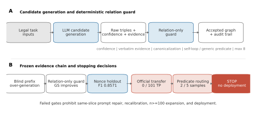
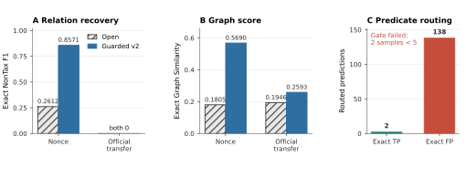

# OntoBridg: Fail-Closed Evaluation of Open-Relation Ontology Learning

**Keywords:** ontology learning; large language models; neuro-symbolic systems; relation extraction; calibration; benchmark contamination

## Abstract

Large language models can generate ontology triples from text, but open-relation generation creates a difficult precision problem: a model may emit many plausible, evidence-linked relations that do not match the benchmark graph. Public ontology resources also create plausible pretraining-exposure confounds. We present **OntoBridg**, an ontology-learning pipeline that treats the language model as a candidate generator and applies relation-channel evidence, confidence, canonicalization, self-loop, predicate, and quantity constraints. We evaluate it on the public LLMs4OL 2026 Task A and Task B training data under a gold-withheld prompt protocol; no result uses hidden test labels or constitutes a leaderboard claim. On relation-density-stratified samples, isolating constraints to the relation channel improves exact Graph Similarity by 0.0315 and 0.0409 for Tasks A and B, but exact non-taxonomic F1 remains zero. On a frozen synthetic nonce holdout, guarding raises non-taxonomic F1 from 0.2612 to 0.8571 with no errors on 60 negated controls. This gain does not transfer to a disjoint, relation-rich official-text slice, where both systems recover 0 of 101 gold relations. Predicate routing recovers two `type` edges but produces 138 official exact false positives and fails a precommitted five-sample support gate. A contamination pilot finds high factual probeability but opposing alias effects across tasks. These results support a fail-closed evaluation protocol rather than a naturalistic performance claim: controlled extraction succeeds, official-text relation recovery remains unsupported, and every calibration and deployment gate stays closed.

## 1 Introduction

Ontology learning converts text into typed entities, taxonomic edges, and non-taxonomic relations. The LLMs4OL program established common tasks and datasets for testing whether large language models (LLMs) can perform these operations across lexical, geographic, biomedical, and web-schema domains [1,2]. More recent systems combine prompting with retrieval or learned graph components. Beliaeva and Rahmatullaev use retrieval-augmented prompting, embedding ensembles, and cross-attention taxonomy induction [3]. Mishra et al. report strong 2026 Task A and Task B scores with retrieval-augmented Qwen2.5-14B, yet extract no non-taxonomic relations [4]. This exposes a central design tension: closed vocabularies can suppress false positives, while open vocabularies are needed when the relevant property inventory is incomplete.

Open generation alone does not solve the problem. A model can extract a relation that is linguistically plausible, grounded in the supplied passage, and still fail exact graph scoring because its predicate, direction, endpoint form, or relation selection differs from the reference graph. In ontology learning, indiscriminate recall is especially costly because every extra edge changes graph neighborhoods and consistency. Evidence constraints can remove unsupported candidates, but they do not determine which of several text-supported facts belongs in a sparse benchmark graph.

Evaluation is complicated further by possible training-data exposure. WordNet, GeoNames, schema.org, and many biomedical ontologies are public, widely mirrored resources. Closed-book recall of their facts is therefore not proof of induction from the supplied text. Black-box contamination tests can establish suspicious distributional evidence without proving that a specific item occurred in a proprietary training corpus [10,11]. Task-level contamination can also make nominally few-shot evaluation behave like recall [12]. For ontology learning, this distinction matters because the benchmark target is itself a public knowledge artifact.

We study these issues through **OntoBridg**, a pipeline in which the LLM generates candidate triples and deterministic postprocessing governs whether relation candidates survive. Our goal is not to claim a new leaderboard score. Instead, we ask where relation constraints work, where they fail, and whether a manifest-frozen fail-closed protocol prevents a controlled positive result from being promoted into an unsupported deployment claim.

The paper makes four contributions:

1. **A gold-withheld failure characterization.** On fixed prefixes of the public 2026 Task A and Task B training sets, gold is excluded from prompts and unconstrained open-relation generation emits 384 and 150 non-taxonomic predictions. It misses Task A's sole non-taxonomic gold edge, while the Task B prefix contains no such gold edge; exact Graph Similarity falls sharply in both tasks.

2. **A relation-channel guard.** Confidence, verbatim evidence, entity and predicate canonicalization, self-loop removal, generic-predicate filtering, and a quantity cap are applied only to non-taxonomic relations. Preserving the typing and taxonomy channels isolates the effect of relation filtering and improves exact Graph Similarity on density-stratified samples.

3. **Independent controlled and transfer tests.** A frozen nonce holdout shows that the guarded extractor can recover new synthetic facts under familiar predicates. A disjoint official-text transfer slice and an independent predicate-routing slice show that this gain does not establish official relation recovery.

4. **A fail-closed evidence protocol.** Calibration, contamination diagnostics, frozen manifests, sample-grouped uncertainty estimates, and minimum positive-sample gates are recorded explicitly. Insufficient support closes the mechanism, confirmatory, and deployment gates instead of triggering same-slice prompt repair.

## 2 Background and Related Work

### 2.1 LLMs for ontology learning

LLMs4OL formalized term typing, taxonomy discovery, and non-taxonomic relation extraction as related ontology-learning capabilities [1]. The 2024 challenge overview established shared-task datasets and reporting conventions [2], and the OntoLearner library later provided a modular integration surface for benchmarking ontology-learning systems [5]. The 2025 Alexbek system demonstrates that no single architecture dominates all stages: retrieval-augmented prompting is used for document-to-term/type extraction, embedding ensembles for typing, and a cross-attention model for taxonomy induction [3]. The 2026 pro-team system similarly combines retrieval with deterministic filtering [4]. Its strong graph scores and empty non-taxonomic relation output motivate our focus on relation-channel behavior.

Classical ontology learning used lexical and lexico-syntactic regularities, including Hearst patterns for hyponymy [6]. Modern LLM systems replace fixed patterns with broader candidate generation, but the underlying need for structural control remains. Ontology matching is a neighboring, not identical, task; systems such as LogMap [7], AgreementMakerLight [8], and BERTMap [9] illustrate how lexical or neural candidates can be combined with logical and structural validation. OntoBridg adopts the same high-level separation between candidate generation and deterministic acceptance while evaluating ontology construction rather than cross-ontology correspondence.

### 2.2 Contamination-aware evaluation

Test-set contamination cannot generally be verified for a closed commercial or hosted model. Oren et al. show that aggregate ordering statistics can provide black-box evidence of test-set exposure [10]. Golchin and Surdeanu use guided prompting to trace contamination signals across datasets and model families [11]. Li and Flanigan demonstrate task contamination, where exposure to task-specific data changes the interpretation of few-shot performance [12]. These methods motivate diagnostics, not binary declarations that individual samples are clean or contaminated.

Our protocol therefore separates three claims. **Probeability** means a model discriminates official facts from constructed controls without seeing task context. **Surface sensitivity** means performance changes after endpoint aliases replace original names. **Verified membership** would require direct knowledge of the model's training corpus, which is unavailable here. We report the first two and do not claim the third.

## 3 Method

### 3.1 Task interface

We use the public LLMs4OL 2026 definitions [13]. In Task A (Flagship), the model receives a text context and predicts primitive ontology triples. In Task B (Reuse), it receives a context, an initial ontology, and the officially supplied term and type lists, and predicts extension triples. Let (x_i) denote the legal input fields for sample (i), (G_i) its locally held gold graph, and (hat{G}_i) the predicted graph. Gold triples are used for selection or scoring only and never enter prompts.

Triples are partitioned into typing, taxonomy, and non-taxonomic channels. The relation experiments exclude self-loops and treat the exact normalized triple

\[
(s,p,o) \in \hat{G}_i \cap G_i
\]

as a true positive. Surface or semantic variants are not counted by the primary exact metric.

### 3.2 Candidate-generation systems

The experiments compare the following system identities:

- **Closed vocabulary:** generate typing and taxonomy triples only.
- **Open vocabulary:** generate typing, taxonomy, and concise non-taxonomic predicates supported by the context.
- **Guarded relation generation:** require every relation candidate to include a confidence score and verbatim evidence.
- **Relation-channel hybrid:** retain typing and taxonomy triples from the legacy open system and substitute only the guarded relation channel.
- **Predicate-routed relation generation:** restrict a relation-only prompt to a frozen eight-predicate inventory for an independent mechanism test.

The hosted backbone is identified by the stable experiment alias `dots3-note-prev`, with temperature zero. Prompt hashes, model-input hashes, postprocessing signatures, attempt counts, and cache identities are retained in the experiment artifacts. Because a hosted alias does not guarantee immutable provider weights, model drift remains a limitation.

### 3.3 Relation guard

Each guarded candidate contains a triple (r=(s,p,o)), a raw confidence (q\in[0,1]), an evidence mode, and one or two verbatim evidence spans. Entity strings are normalized against exact context surfaces and the official input inventory. Predicate aliases are canonicalized with direction-aware reversal where required.

An explicit candidate requires one verbatim span containing both endpoints and raw confidence (q\geq0.85). A cross-sentence candidate requires two distinct verbatim spans, joint endpoint coverage, a maximum normalized gap of 600 characters, and (q\geq0.95). Candidates are rejected for invalid or non-verbatim evidence, missing endpoints, self-loops, generic predicates, or failure of an optional frozen predicate policy. Surviving candidates are ranked by confidence and capped at eight relations per sample. Formally,

\[
\operatorname{accept}(r)=I_q I_e I_{\neg self} I_{\neg generic} I_p I_k,
\]

where (I_q) is the mode-specific confidence test, (I_e) is the evidence test, (I_p) is the optional predicate policy, and (I_k) represents the per-sample quantity cap. The guard is deterministic once the raw generation is cached.

Applying the guard directly to a full generated graph can also change typing and taxonomy behavior because the prompt itself changes. The hybrid comparison avoids this confound: it holds the legacy typing/taxonomy output fixed and changes only accepted relations.

### 3.4 Calibration and fail-closed gates

Raw generation and postprocessing have separate cache identities. A new calibrator can therefore be fit and replayed locally without another model call. Calibration is considered deployable only when its labels are independent of the evaluation slice and exact positives occur in at least five independent samples. Samples, rather than candidates, define cross-validation and bootstrap clusters.

Passing a probability metric is not sufficient. A confirmatory gate also requires that a frozen decision rule retain exact relations in at least five independent samples on an untouched slice. Resubstitution, same-slice threshold search, weak labels without human audit, and post-hoc surface rules cannot open the gate. Every artifact records `scientific_deployable` and `confirmatory_eligible`; both default to false.

### 3.5 Contamination diagnostics

The closed-book probe asks the model to discriminate official facts from matched constructed controls without task context. We summarize discrimination with AUROC and a sample-cluster bootstrap interval. A paired surface test replaces endpoint names with aliases while preserving graph structure. Neither test provides verified training-set membership. Probe results are descriptive and cannot tune generation, filtering, calibration, or deployment.

## 4 Experimental Design

### 4.1 Data and frozen evidence partitions

All official-data experiments use the public LLMs4OL 2026 Task A and Task B training JSON files [13]. The challenge repository is MIT-licensed; upstream ontology resources, especially UMLS-derived material, may impose additional terms. We therefore release scripts, manifests, hashes, prompts, and aggregate results, but do not redistribute third-party source data in the artifact.

Table 1 separates the evidence partitions. Gold-stratified sets are useful diagnostics but are not unbiased estimates of the natural task distribution.

**Table 1. Frozen evidence partitions.**

| Partition | Source | Samples | Purpose | Selection status |
|---|---|---:|---|---|
| Blind prefix | Task A + B train | 30 per task | Closed vs. open baseline | Fixed prefix; gold withheld from prompts |
| Density strata | Task A + B train | 15 per task | Relation-only guard comparison | Gold-stratified low/medium/high density |
| Independent v2 calibration | Task A + B train | 39 | Candidate calibration support | Disjoint; relation-enriched |
| V5 confirmatory | Task A train | 24 | Frozen decision-rule test | Disjoint; predicate-balanced, endpoint-visible |
| Nonce holdout | Synthetic context-only | 30 | Controlled new-fact extraction | Frozen before generation |
| Official transfer | Task A train | 30 | Transfer of nonce result | Disjoint; relation-rich, gold-stratified |
| Predicate routing | Task A train | 27 | Independent routing mechanism test | Disjoint 8/8/3/8 predicate strata |

The nonce holdout contains 120 balanced positive relations, 60 negated co-occurrence controls, and 300 newly generated opaque entities. It has zero exact entity-string and gold-triple overlap with the official Task A/B training data. It is synthetic and low-overlap, not a verified temporal benchmark.

### 4.2 Metrics and uncertainty

We report micro precision, recall, and F1 for typing, taxonomy, and non-taxonomic relations. The primary graph metric is the official exact Graph Similarity implementation distributed with the 2026 challenge [13]:

\[
GS=\frac{EdgeF1+NeighborhoodSimilarity+TaxonomySimilarity}{3}.
\]

The composite ((TypingF1+TaxonomyF1+GS)/3) is an internal summary and not an official leaderboard score. Exact matching is primary. A frozen semantic secondary analysis is reported in the supplement; its model revision and threshold were locked before scoring.

Where reported, uncertainty intervals use 10,000 sample-cluster bootstrap replicates. For paired system comparisons, samples are resampled jointly within prespecified strata. We emphasize effect sizes and support counts rather than null-hypothesis significance tests because several slices are small and purposefully stratified.

### 4.3 Research questions

- **RQ1:** Does isolating symbolic constraints to the relation channel improve graph precision without changing typing or taxonomy output?
- **RQ2:** Does guarded extraction on a controlled nonce holdout transfer to relation-rich official text?
- **RQ3:** Do calibration and predicate routing satisfy prespecified independent-sample support gates?
- **RQ4:** Do closed-book probeability and endpoint aliasing support a contamination-induced performance-inflation claim?

**Figure 1. Evaluation and decision flow.** Raw LLM generations are processed by a deterministic relation guard and evaluated across increasingly demanding evidence partitions. A positive controlled result advances to independent official-text tests; failed support gates stop expansion and deployment rather than triggering same-slice repair.

## 5 Results

### 5.1 Blind official-training prefix

All 120 task-system-sample units complete. Task A prompts contain context only; Task B prompts contain only official task inputs. Table 2 shows that open generation does not improve the blind prefix. It emits 384 Task A predictions and misses Task A's sole non-taxonomic gold edge; it emits 150 Task B predictions on a prefix containing no non-taxonomic gold edge. Relative to closed generation, exact Graph Similarity falls by 0.2801 on Task A and 0.2927 on Task B. The prefix therefore diagnoses over-generation but cannot estimate relation recall reliably.

**Table 2. Gold-withheld official-training prefix (30 samples per task).**

| Task | System | Typing F1 | Taxonomy F1 | NonTax F1 | Exact GS | NonTax pred/gold |
|---|---|---:|---:|---:|---:|---:|
| A | Closed | **0.1400** | **0.4903** | 0 | **0.4404** | 0 / 1 |
| A | Open | 0.1356 | 0.3516 | 0 | 0.1603 | 384 / 1 |
| B | Closed | 0.8824 | **0.9474** | 0 | **0.9375** | 0 / 0 |
| B | Open | **1.0000** | 0.8966 | 0 | 0.6449 | 150 / 0 |

### 5.2 Relation-channel isolation

The density-stratified evaluation contains 63 Task A and 53 Task B non-taxonomic gold edges. Table 3 reports the stable comparison: typing and taxonomy outputs are inherited from the same open run, while only the relation channel changes. The v1 hybrid removes 216 Task A and 42 Task B relation predictions, improving exact Graph Similarity by 0.0315 and 0.0409. V2 adds entity/predicate canonicalization and cross-sentence evidence. It improves Task A GS by 0.0327 over open generation but is less conservative on Task B.

No guarded hybrid recovers an exact relation on this slice. V2 generates the one Task B relation recovered by the unguarded system at confidence 0.95, but its evidence spans are 1,604 normalized characters apart and the frozen 600-character rule rejects it. A post-hoc wider gap accepts that edge and additional false positives; it is reported only as a mechanism diagnostic and does not change the primary result.

**Table 3. Relation-density-stratified hybrid comparison (15 samples per task).**

| Task | Relation channel | Typing F1 | Taxonomy F1 | NonTax F1 | Exact GS | NonTax predictions |
|---|---|---:|---:|---:|---:|---:|
| A | Open | 0.3077 | 0.3475 | 0 | 0.1825 | 250 |
| A | Guarded v1 | 0.3077 | 0.3475 | 0 | **0.2140** | 34 |
| A | Guarded v2 | 0.3077 | 0.3475 | 0 | **0.2152** | 54 |
| B | Open | 0.6000 | 0.7500 | **0.0202** | 0.5598 | 46 |
| B | Guarded v1 | 0.6000 | 0.7500 | 0 | **0.6007** | 4 |
| B | Guarded v2 | 0.6000 | 0.7500 | 0 | 0.5766 | 19 |

These results answer RQ1 narrowly: relation-channel isolation improves graph precision by suppressing unmatched edges, but evidence filtering alone does not establish relation recovery.

### 5.3 Calibration remains fail-closed

The independent v2 calibration pool contains 144 eligible candidates but only four exact positives from three samples. Calibration reduces resubstitution Brier score from 0.8429 to 0.0270 and expected calibration error (ECE) from 0.9024 to 0.0113, yet it fails the five-positive-sample requirement.

Dual-model weak annotation supplies more positives but has low relation-set agreement (micro Jaccard 0.3436), no held-out human audit, and no overlap with the packet's single official non-taxonomic edge. In sample-grouped five-fold evaluation, calibration reduces Brier/ECE to 0.1134/0.0045, but every fold maps the narrow 0.85-1.00 raw confidence range to one probability block. This is base-rate shrinkage, not learned ranking.

The untouched 24-sample v5 confirmatory slice gives the decisive test. Base v5 yields 4 TP in 15 predictions from four samples (F1 0.1159). The frozen calibrator improves candidate Brier/ECE from 0.6707/0.6840 to 0.2109/0.1238, but its threshold removes one TP, leaving 3 TP in 14 predictions from three samples (F1 0.0882). The confirmatory and deployment gates therefore remain closed. The sample-cluster interval for calibrated-minus-base F1 is [-0.1064, 0].

### 5.4 Contamination diagnostics do not support a global inflation claim

The closed-book probe completes 30 samples and 214 balanced items. AUROC is 0.9780 with a 10,000-replicate sample-cluster 95% interval of [0.9484, 0.9982], showing that official facts are highly probeable. Probeability, however, has weak and inconsistent association with per-sample Graph Similarity.

Endpoint aliasing also has opposing effects. Original-minus-alias GS is negative for Task A closed/open (-0.0921 and -0.1102) but positive for Task B closed/open (+0.1557 and +0.1917). Restricting to fully endpoint-visible samples preserves this pattern. These results show task-dependent surface sensitivity, not verified training membership or a general contamination-induced score increase. RQ4 is therefore answered in the negative.

### 5.5 Controlled extraction does not transfer to official text

The nonce holdout provides the strongest positive relation result. Guarded v2 raises exact non-taxonomic F1 from 0.2612 to 0.8571 and exact GS from 0.1805 to 0.5690. Both systems produce zero predictions on all 60 negated controls. Guarded performance is perfect on canonical language (F1 1.0000) but falls to 0.7119 on paraphrases, demonstrating sensitivity even in the controlled setting.

The disjoint official-text transfer slice reverses the conclusion. It contains 101 non-self non-taxonomic gold edges, 89 with both endpoints visible in the compressed context. Neither system recovers one. Guarded v2 reduces predictions from 424 to 143 and raises exact GS from 0.1946 to 0.2593, but exact relation precision, recall, and F1 remain zero. A zero-call audit finds no exact TP among 225 raw guarded candidates and no raw candidate using an exact gold predicate. The guard did not remove a latent correct relation; the raw predicate family was misaligned with the reference inventory.

**Table 4. Controlled nonce result and official-text transfer.**

| Partition | System | Precision | Recall | NonTax F1 | Exact GS | Predictions / gold |
|---|---|---:|---:|---:|---:|---:|
| Nonce | Open | 0.2222 | 0.3167 | 0.2612 | 0.1805 | 171 / 120 |
| Nonce | Guarded v2 | **0.8644** | **0.8500** | **0.8571** | **0.5690** | 118 / 120 |
| Official transfer | Open | 0 | 0 | 0 | 0.1946 | 424 / 101 |
| Official transfer | Guarded v2 | 0 | 0 | 0 | **0.2593** | 143 / 101 |

**Figure 2. Controlled success and official-text failure.** Panel A contrasts non-taxonomic F1 on the nonce and official-transfer partitions. Panel B reports the corresponding exact Graph Similarity. Panel C shows that independent predicate routing produces two official exact true positives but 138 exact false positives. Exact false positives are scoring outcomes, not human-adjudicated semantic errors.

### 5.6 Predicate routing gives narrow recovery and fails its gate

The independent routing packet freezes 27 Task A samples after the official-transfer diagnosis. It contains 69 target gold edges across `equivalent class`, `disjoint with`, `type`, and `database_cross_reference` strata and has zero sample, context, or exact-gold overlap with prior evidence. General relation-only v3 and routed v6 differ only in prompt identity and share the same postprocessor.

Routed v6 raises four-stratum macro target F1 from 0 to 0.0526, but pooled precision/recall/F1 is 0.0143/0.0290/0.0191. Both true positives are `type` edges from two independent samples. The other three strata remain at zero TP, so the five-positive-sample mechanism gate fails.

**Table 5. Independent predicate-routing result.**

| System | Macro target F1 | Pooled P / R / F1 | TP / FP / FN | TP-positive samples | Exact GS |
|---|---:|---:|---:|---:|---:|
| General v3 | 0 | 0 / 0 / 0 | 0 / 0 / 69 | 0 | 0 |
| Routed v6 | **0.0526** | 0.0143 / 0.0290 / 0.0191 | 2 / 138 / 67 | 2 | 0.0016 |

The post-hoc audit clarifies the failure. Of 140 accepted routed outputs, 120 are `type`; all 138 exact false positives contain accepted explicit or cross-sentence evidence, and 133 bind both endpoints verbatim to the context. Routing therefore changes the failure mode from out-of-inventory predicates to broad, evidence-bound off-gold generation. Because official gold completeness is not established and no independent semantic adjudication was performed, off-gold predictions cannot be declared semantically correct or incorrect. The audit does not reopen the gate.

## 6 Discussion

### 6.1 Evidence is necessary but not sufficient

The relation guard consistently reduces unmatched predictions and can greatly improve graph-level scores when typing and taxonomy are held fixed. Its success on the nonce holdout shows that the implementation can recover unseen entity combinations from supplied text. The official transfer and routing results show the boundary: evidence verifies that text supports an assertion, not that the benchmark expects that assertion or predicate serialization.

This distinction is important for ontology construction. A passage can support many defensible type or identity statements while a reference graph records only a subset. Under exact evaluation, these become false positives even when both endpoints and an evidence span are valid. Better confidence calibration cannot resolve incomplete or selectively scoped supervision unless the calibration labels reflect that same selection process.

### 6.2 Why fail-closed evaluation matters

Several intermediate analyses could have been presented optimistically: large calibration improvements on sparse labels, a strong controlled nonce result, a wider evidence gap that restores one relation, or a post-hoc symmetric-edge rule. Each fails a different independence or support requirement. The protocol turns these failures into explicit stopping decisions. It blocks same-slice repair, prevents weak labels from being renamed as human annotation, and avoids scaling an intervention whose mechanism gate failed.

The resulting contribution is therefore methodological as much as algorithmic. OntoBridg provides a reproducible sequence for separating candidate generation, deterministic filtering, calibration, controlled extraction, official-text transfer, and independent mechanism testing. Negative results remain useful because their scope and stopping rules are auditable.

### 6.3 Implications for LLMs4OL evaluation

First, relation-channel and core-graph metrics should be reported separately. A model can improve typing while harming graph similarity through relation over-generation. Second, public-training-data experiments should be labeled as such; they do not substitute for hidden-test or temporal evaluation. Third, contamination probes should not create unverified clean/polluted labels. Finally, benchmarks with sparse relation annotations may need explicit closed predicate inventories, completeness statements, or semantic adjudication protocols if they intend to reward plausible additional relations.

## 7 Limitations, Ethics, and Reproducibility

**Training rather than hidden test data.** All official-data results use public 2026 training files. Gold-stratified transfer and routing slices are mechanism diagnostics, not unbiased performance estimates or leaderboard submissions.

**One hosted model.** The primary experiments use one OpenAI-compatible hosted model alias. Temperature is zero and all prompts are hashed, but provider-side weights and serving behavior are not independently versioned. Cross-model generalization is unknown.

**Sparse and potentially incomplete gold.** Exact scoring is appropriate for challenge comparability but cannot adjudicate plausible off-gold relations. The routing audit demonstrates this ambiguity. No human semantic audit is claimed.

**Synthetic holdout.** Nonce entities and relation facts are newly generated and have no exact overlap with official data, but the relation templates and predicates are familiar. The holdout tests controlled new-fact extraction, not natural language coverage or unseen-predicate discovery.

**Calibration support.** Independent exact positives remain too sparse for deployment. Dual-model annotations are exploratory weak labels with low agreement and no held-out human audit. They cannot open a confirmatory gate.

**Contamination inference.** High closed-book AUROC may reflect general public knowledge, control construction artifacts, or training exposure. Endpoint aliasing changes lexical difficulty as well as memorization cues. We do not identify individual training examples or claim verified membership.

**Data licensing and privacy.** Experiments use public challenge files and synthetic text; no personal data are introduced. The challenge repository is MIT-licensed, while upstream ontology resources may have additional terms. The artifact excludes third-party datasets and API credentials. It includes code, frozen manifests, hashes, prompts, aggregate result JSON, and zero-call replay instructions.

**Resource use.** Cached raw generations and signed postprocessing outputs avoid repeated API calls during calibration and audit. All reported post-hoc analyses are local. API attempt counts, retries, and final failures are retained rather than silently discarded.

## 8 Conclusion

OntoBridg treats LLM-based ontology learning as candidate generation followed by deterministic, fail-closed evaluation. Relation-only guards improve graph precision and recover controlled synthetic relations, but that success does not transfer to relation-rich official text. Predicate routing obtains two exact `type` relations yet fails its independent-sample support gate, while most off-gold outputs remain evidence-bound and semantically unadjudicated. Contamination diagnostics reveal high factual probeability without supporting a global score-inflation claim. The defensible result is not that open-relation ontology learning is solved, but that controlled positives, transfer failures, and deployment decisions can be separated reproducibly. On the current evidence, naturalistic open-relation gains remain unsupported and every deployment gate remains closed.

## References

1. H. Babaei Giglou, J. D'Souza, and S. Auer. LLMs4OL: Large Language Models for Ontology Learning. In *The Semantic Web - ISWC 2023*, pp. 408-427, 2023. https://doi.org/10.1007/978-3-031-47240-4_22.
2. H. Babaei Giglou, J. D'Souza, and S. Auer. LLMs4OL 2024 Overview: The 1st Large Language Models for Ontology Learning Challenge. *Open Conference Proceedings*, 4:3-16, 2024. https://doi.org/10.52825/ocp.v4i.2473.
3. A. Beliaeva and T. Rahmatullaev. Heterogeneous LLM Methods for Ontology Learning (Few-Shot Prompting, Ensemble Typing, and Attention-Based Taxonomies). arXiv:2508.19428, 2025. https://doi.org/10.48550/arXiv.2508.19428.
4. S. Mishra, D. R. Meena, M. Ojha, K. P. Singh, and K. Singh. pro-team at LLMs4OL 2026 Tasks Flagship and Reuse: Retrieval-Augmented Generation and Vocabulary-Constrained Filtering for Ontology Learning. arXiv:2608.27101, 2026. https://doi.org/10.48550/arXiv.2608.27101.
5. H. Babaei Giglou, J. D'Souza, A. Aioanei, N. Mihindukulasooriya, and S. Auer. OntoLearner: A Modular Python Library for Ontology Learning with Large Language Models. arXiv:2607.01977, 2026.
6. M. A. Hearst. Automatic Acquisition of Hyponyms from Large Text Corpora. In *COLING 1992*, p. 539, 1992. https://doi.org/10.3115/992133.992154.
7. E. Jimenez-Ruiz and B. Cuenca Grau. LogMap: Logic-Based and Scalable Ontology Matching. In *The Semantic Web - ISWC 2011*, pp. 273-288, 2011. https://doi.org/10.1007/978-3-642-25073-6_18.
8. D. Faria, C. Pesquita, E. Santos, M. Palmonari, I. F. Cruz, and F. M. Couto. The AgreementMakerLight Ontology Matching System. In *OTM 2013 Conferences*, pp. 527-541, 2013. https://doi.org/10.1007/978-3-642-41030-7_38.
9. Y. He, J. Chen, D. Antonyrajah, and I. Horrocks. BERTMap: A BERT-Based Ontology Alignment System. *Proceedings of the AAAI Conference on Artificial Intelligence*, 36(5):5684-5691, 2022. https://doi.org/10.1609/aaai.v36i5.20510.
10. Y. Oren, N. Meister, N. Chatterji, F. Ladhak, and T. B. Hashimoto. Proving Test Set Contamination in Black-Box Language Models. arXiv:2310.17623, 2023. https://doi.org/10.48550/arXiv.2310.17623.
11. S. Golchin and M. Surdeanu. Time Travel in LLMs: Tracing Data Contamination in Large Language Models. In *ICLR 2024*, 2024. arXiv:2308.08493.
12. C. Li and J. Flanigan. Task Contamination: Language Models May Not Be Few-Shot Anymore. *Proceedings of the AAAI Conference on Artificial Intelligence*, 38(16):18471-18480, 2024. https://doi.org/10.1609/aaai.v38i16.29808.
13. LLMs4OL Organizers. LLMs4OL Challenge Repository: 2026 Tasks and Metrics. GitHub repository, 2026. https://github.com/LLMs4OL/LLMs4OL-Challenge (accessed 2026-09-28).
